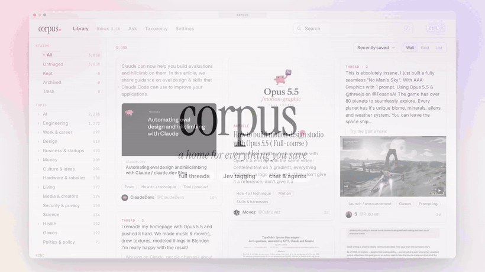

# corpus

A self-hosted home for your saved bookmarks. Corpus reads X bookmarks from [FieldTheory](https://github.com/afar1/fieldtheory-cli), fetches full threads, tags them with [TypeSafe Jev](https://typesafe.ai), and lets you read, highlight, triage, and ask questions about them. It keeps its own copy of every post's images, so nothing is lost when a post is deleted on X.



[Watch the demo with sound (1:27)](docs/demo.mp4)

Corpus keeps its own state in `data/` and never writes to your FieldTheory files.

## Getting started

Requires Node 22.5+.

```sh
cp .env.example .env    # keys, password hash, bookmark location
npm start               # http://127.0.0.1:4173
npm run backfill        # optional: fetch every thread and tag it
```

| `.env` setting | Purpose |
| --- | --- |
| `BOOKMARK_SOURCE`, `BOOKMARK_DB` | FieldTheory export (default `~/.ft-bookmarks`) |
| `X_COOKIE_ENV` | File with `CT0` and `AUTH_TOKEN`, for read-only thread fetching |
| `TYPESAFE_API_KEY` | Jev tagging |
| `OPENROUTER_API_KEY` | Chat models |
| `CORPUS_PASSWORD_HASH`, `CORPUS_SESSION_SECRET` | Site password |
| `CORPUS_MCP_TOKEN` | MCP access token |

## Connecting an agent

Paste this into any MCP-capable agent:

```text
Connect yourself to my Corpus bookmark library over MCP. Fetch and follow the instructions at https://your-host/connect.md.

URL: https://your-host/mcp
Token: <CORPUS_MCP_TOKEN>
```

Settings → Agents & MCP copies it with your URL and token filled in.

## How it works

`server.mjs` serves a plain JavaScript front end from `public/` and builds the index with `lib/`:

- `build.mjs`: index and tag scoring
- `x-client.mjs`, `enricher.mjs`: thread fetching
- `jev.mjs`: classification
- `ops.mjs`: every action, shared by chat and MCP
- `archive.mjs`: local copies of post images
- `scratchpad.mjs`: the inbox scratchpad shared with agents

See [docs/guide.md](docs/guide.md) for details.
